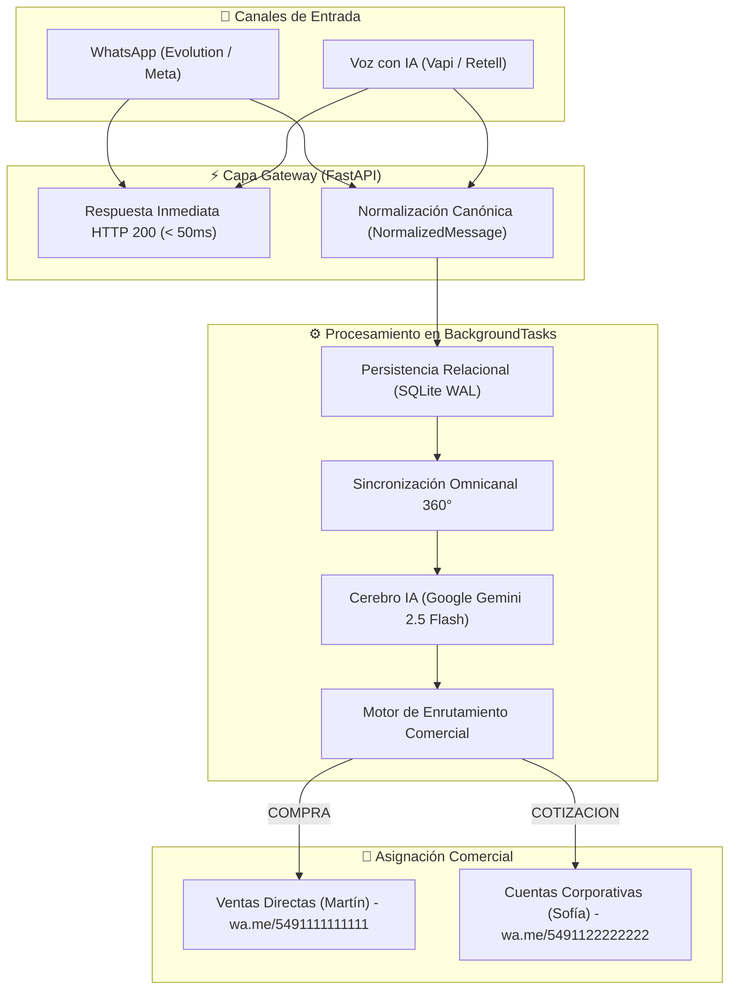

# 🚀 Asistente Inteligente Omnicanal de WhatsApp y Voz con Enrutamiento Comercial

Sistema de atención automatizada multicanal de nivel empresarial que procesa requerimientos de clientes vía **WhatsApp** y **Llamadas de Voz (IA)**, clasifica la intención comercial con IA (**COMPRA** vs. **COTIZACIÓN**) y enruta automáticamente la conversación y alertas hacia el asesor asignado con enlaces directos `wa.me/`.

---

## 📅 Roadmap de Ejecución (7 Días Completados al 100%)

- [x] **Día 1: Configuración de la Pasarela de Mensajería (WhatsApp Webhook)**
  - Arquitectura modular asíncrona basada en FastAPI + Pydantic v2.
  - Normalizador multicanal ([`NormalizedMessage`](file:///home/martin/development/asistente-omnicanal/app/schemas/webhook.py)) agnóstico del proveedor (Evolution API, Meta Cloud API, Voz).
  - Protección anti-bucles (filtro de `fromMe: true`) y respuesta HTTP ultra-rápida (< 50ms) vía `BackgroundTasks`.
  - Simulador de eventos de WhatsApp y suite de pruebas automatizadas con `pytest`.
- [x] **Día 2: Estructuración de la Base de Datos Local y Gestión de Memoria por Cliente**
  - Motor asíncrono con SQLAlchemy 2.0 y SQLite (`aiosqlite`).
  - Modelos relacionales: [`Customer`](file:///home/martin/development/asistente-omnicanal/app/models/customer.py) (lead comercial), [`Conversation`](file:///home/martin/development/asistente-omnicanal/app/models/conversation.py) (sesión con estado e intención) y [`Message`](file:///home/martin/development/asistente-omnicanal/app/models/message.py) (historial cronológico).
  - [`ConversationMemoryService`](file:///home/martin/development/asistente-omnicanal/app/services/memory_service.py): resolución de clientes por teléfono internacional, control de expiración de sesiones (24h) y formateo de historial para LLMs.
  - Endpoints REST para inspección de clientes e historial (`/api/v1/conversations/...`).
- [x] **Día 3: Motor de Clasificación con IA (Google Gemini: COMPRA vs. COTIZACIÓN)**
  - Integración nativa con `google-genai` y modelo `gemini-2.5-flash`.
  - Esquema estricto con Pydantic ([`IntentClassificationResult`](file:///home/martin/development/asistente-omnicanal/app/schemas/ai.py)): `intent`, `confidence`, `urgency_level`, `reasoning`, `product_interest`, `quantity` y `suggested_reply`.
  - System Prompt especializado con reglas de desempate comercial y evaluación del contexto conversacional acumulado.
  - Heurística de respaldo determinista resiliente ante picos o indisponibilidad temporal de API externa.
  - Endpoint interactivo `POST /api/v1/ai/classify` para pruebas rápidas.
- [x] **Día 4: Enrutamiento Inteligente y Alertas Comerciales Automáticas**
  - Mapeo de colas comerciales: Asesor de Cierre y Ventas Directas (`COMPRA`) vs. Asesor de Cuentas Corporativas (`COTIZACIÓN`).
  - Ficha de lead enriquecida ([`LeadCard`](file:///home/martin/development/asistente-omnicanal/app/schemas/routing.py)) con enlace directo con un clic a WhatsApp (`https://wa.me/...`).
  - Despachador de mensajes salientes ([`WhatsAppClientService`](file:///home/martin/development/asistente-omnicanal/app/services/whatsapp_client.py)) con modo simulación y soporte de Evolution API.
  - Auto-confirmación cordial al cliente asignando a su asesor y actualización de estado a `routed`.
  - Endpoints de consulta de asesores y leads comerciales (`/api/v1/routing/...`).
- [x] **Día 5: Integración del Módulo de Voz con IA (Adaptador Híbrido Vapi / Retell AI)**
  - Pasarela de voz unificada ([`VoiceAdapterService`](file:///home/martin/development/asistente-omnicanal/app/services/voice_adapter.py)) con auto-detección y extracción de transcripciones, grabaciones y resúmenes.
  - Endpoints dedicados: `POST /api/v1/webhooks/voice/vapi` y `POST /api/v1/webhooks/voice/retell`, además del endpoint universal `POST /api/v1/webhooks/voice`.
  - Mapeo transparente al modelo canónico [`NormalizedMessage`](file:///home/martin/development/asistente-omnicanal/app/schemas/webhook.py) con canal `voice` y formato de alerta específico para llamadas.
  - CLI de simulación interactiva ([`tests/simulate_voice.py`](file:///home/martin/development/asistente-omnicanal/tests/simulate_voice.py)).
- [x] **Día 6: Sincronización Omnicanal (Unificación de Estado entre Voz y Texto)**
  - Servicio de sincronización 360° ([`OmnichannelSyncService`](file:///home/martin/development/asistente-omnicanal/app/services/omnichannel_service.py)) con fusión cronológica de timeline y etiquetas de canal (`[Voz]` y `[WhatsApp]`).
  - Detección de continuidad de canal y herencia de asesor comercial: si el cliente llama por voz y luego escribe por WhatsApp (o viceversa), preserva al asesor asignado y mantiene la coherencia.
  - Contexto unificado para Google Gemini con memoria cruzada de todos los canales de contacto.
  - Endpoints de consulta: `GET /api/v1/customers/{phone}/timeline` y `/cross-channel`.
- [x] **Día 7: Pruebas de Estrés, Depuración y Despliegue del MVP Funcional**
  - Fortalecimiento de concurrencia en SQLite: activación de modo WAL (`PRAGMA journal_mode=WAL;`), `PRAGMA busy_timeout=10000;` y protección contra colisiones concurrentes en clientes (`IntegrityError`).
  - Script de pruebas de estrés y alta concurrencia ([`tests/stress_test.py`](file:///home/martin/development/asistente-omnicanal/tests/stress_test.py)) con 50 peticiones concurrentes simultáneas mixtas (WhatsApp + Vapi + Retell).
  - Suite de pruebas de regresión completa con 27 pruebas automatizadas (`pytest`) pasando al 100%.
  - Empaquetado para despliegue productivo: [`Dockerfile`](file:///home/martin/development/asistente-omnicanal/Dockerfile), [`docker-compose.yml`](file:///home/martin/development/asistente-omnicanal/docker-compose.yml), [`.dockerignore`](file:///home/martin/development/asistente-omnicanal/.dockerignore) y script de inicio seguro [`scripts/start.sh`](file:///home/martin/development/asistente-omnicanal/scripts/start.sh).

---

## 🏗️ Arquitectura Completa del Sistema

```
asistente-omnicanal/
├── app/
│   ├── api/
│   │   ├── router.py               # Agregador central de routers API v1
│   │   └── v1/
│   │       ├── ai.py               # Endpoint interactivo de clasificación IA
│   │       ├── conversations.py    # Historial y gestión de conversaciones
│   │       ├── customers.py        # Timeline omnicanal 360° del cliente
│   │       ├── health.py           # Endpoint de salud y monitorización (/health)
│   │       ├── routing.py          # Consulta de asesores y leads comerciales
│   │       ├── voice.py            # Webhooks para Vapi AI y Retell AI
│   │       └── webhooks.py         # Webhook para WhatsApp (Evolution / Meta)
│   ├── core/
│   │   ├── config.py               # Configuración Pydantic Settings (.env)
│   │   └── logger.py               # Logging estructurado con marcas de tiempo
│   ├── database/
│   │   ├── base.py                 # Declarative Base SQLAlchemy
│   │   └── session.py              # Motor asíncrono con SQLite WAL y timeouts
│   ├── models/
│   │   ├── conversation.py         # Modelo Conversation
│   │   ├── customer.py             # Modelo Customer (prospecto/lead)
│   │   └── message.py              # Modelo Message
│   ├── schemas/
│   │   ├── ai.py                   # IntentClassificationResult
│   │   ├── evolution.py            # Payloads de Evolution API
│   │   ├── omnichannel.py          # Timeline y contexto cross-channel
│   │   ├── routing.py              # LeadCard y AdvisorInfo
│   │   ├── voice.py                # Payloads de Vapi y Retell AI
│   │   └── webhook.py              # NormalizedMessage y WebhookAckResponse
│   ├── services/
│   │   ├── ai_classifier.py        # Motor de IA con Google Gemini 2.5 Flash
│   │   ├── memory_service.py       # Persistencia y ciclo de vida de sesiones
│   │   ├── message_processor.py    # Deduplicación y orquestador BackgroundTasks
│   │   ├── omnichannel_service.py  # Fusión de timelines e interoperabilidad
│   │   ├── routing_service.py      # Enrutamiento comercial y generación de alertas
│   │   ├── voice_adapter.py        # Adaptador híbrido Vapi / Retell AI
│   │   └── whatsapp_client.py      # Despacho de mensajes salientes (wa.me)
│   └── main.py                     # Entrypoint de FastAPI y middlewares
├── data/                           # Almacén de base de datos SQLite (assistant.db)
├── scripts/
│   └── start.sh                    # Script de arranque en producción
├── tests/
│   ├── simulate_voice.py           # CLI simulador de llamadas de voz
│   ├── simulate_webhook.py         # CLI simulador de mensajes de WhatsApp
│   ├── stress_test.py              # Script de prueba de estrés y alta concurrencia
│   ├── test_ai_classifier.py       # Tests unitarios del clasificador IA
│   ├── test_memory.py              # Tests de persistencia y base de datos
│   ├── test_omnichannel.py         # Tests de sincronización omnicanal
│   ├── test_routing.py             # Tests de enrutamiento y alertas
│   ├── test_stress.py              # Test de concurrencia pytest
│   ├── test_voice.py               # Tests del adaptador de voz
│   └── test_webhook.py             # Tests de webhooks y endpoints
├── .dockerignore                   # Exclusión de archivos en la imagen Docker
├── .env.example                    # Plantilla de variables de entorno
├── docker-compose.yml              # Orquestador Docker Compose para producción
├── Dockerfile                      # Imagen Docker optimizada (python:3.12-slim)
├── requirements.txt                # Dependencias fijadas del proyecto
└── README.md
```

---

## ⚡ Flujo Integral Omnicanal



---

## 🚀 Despliegue y Puesta en Producción

### Opción A: Despliegue con Docker Compose (Recomendado)

1. **Configurar el entorno:**
   ```bash
   cp .env.example .env
   # Editar .env con tus credenciales (GEMINI_API_KEY, tokens, etc.)
   ```

2. **Compilar y levantar en segundo plano:**
   ```bash
   docker compose up -d --build
   ```

3. **Verificar estado y registros:**
   ```bash
   docker compose ps
   docker compose logs -f asistente-api
   ```

---

### Opción B: Despliegue Nativo en Linux / Servidor

1. **Crear y activar entorno virtual:**
   ```bash
   python3 -m venv venv
   source venv/bin/activate
   pip install --upgrade pip
   pip install -r requirements.txt
   ```

2. **Iniciar servidor en producción:**
   ```bash
   ./scripts/start.sh
   ```
   O en modo desarrollo con recarga automática:
   ```bash
   uvicorn app.main:app --reload --host 0.0.0.0 --port 8000
   ```

---

## 🧪 Pruebas Automatizadas y de Estrés

### 1. Ejecutar la Suite Completa de Tests (27/27)
```bash
pytest -v tests/
```

### 2. Ejecutar la Prueba de Estrés de Alta Concurrencia
Simula 50 peticiones concurrentes simultáneas de WhatsApp y llamadas de voz:
```bash
# Modo directo ASGI (in-memory, sin servidor externo necesario):
python tests/stress_test.py --asgi --concurrency 50 --total 50

# Modo HTTP contra servidor en ejecución:
python tests/stress_test.py --url http://localhost:8000 --concurrency 50 --total 50
```

### 3. Simuladores Interactivos por Canal
```bash
# Simular mensaje de WhatsApp (Compra o Cotización)
python tests/simulate_webhook.py --type compra
python tests/simulate_webhook.py --type cotizacion

# Simular llamada de voz (Vapi o Retell)
python tests/simulate_voice.py --provider vapi --type compra
python tests/simulate_voice.py --provider retell --type cotizacion
```

---

## 📖 Documentación Interactiva de la API
- **Swagger UI:** `http://localhost:8000/docs`
- **ReDoc:** `http://localhost:8000/redoc`
- **Healthcheck:** `http://localhost:8000/health`
